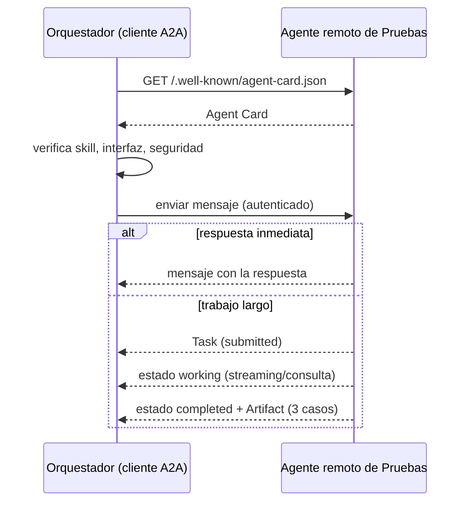

# Equipo de agentes — revisión de `usuarios.py`

Tarea: **antes de abrir un pull request, revisar `usuarios.py`** (ruta exacta: `usuarios.py`, en la raíz del repositorio).

## Parte 1 — Diseño del equipo

| Agente | Misión | Herramientas autorizadas | Entrada | Salida | Límites |
|---|---|---|---|---|---|
| Orquestador | repartir la revisión de `usuarios.py` y consolidar | ninguna propia (solo delega) | ruta `usuarios.py` | tabla con hallazgos de seguridad y casos de prueba | no modifica archivos |
| Especialista 1 — Seguridad (`revisor-seguridad`) | buscar claves/tokens escritos en `usuarios.py` y entradas sin validar | `Read`, `Grep`, `Glob` | ruta `usuarios.py` | lista: línea, problema, severidad (más el texto de la línea) | solo ese archivo; no escribe |
| Especialista 2 — Pruebas | proponer 3 casos de prueba que faltan para `usuarios.py` | `Read` | ruta `usuarios.py` | lista: nombre del caso y qué verifica | solo propone; no escribe pruebas |

### 1. Diagrama del flujo (paralelo + checkpoint humano)

Los dos especialistas no dependen uno del otro, así que corren **en paralelo**.

```mermaid
flowchart TD
    P([Persona: "revisa usuarios.py"]) --> O[Orquestador]
    O -->|ruta usuarios.py| E1[Especialista 1<br/>Seguridad]
    O -->|ruta usuarios.py| E2[Especialista 2<br/>Pruebas faltantes]
    E1 -->|hallazgos: línea, problema, severidad| C[Orquestador consolida<br/>en una tabla]
    E2 -->|3 casos de prueba| C
    C --> H{{CHECKPOINT HUMANO<br/>la persona revisa y aprueba}}
    H -->|aprueba| X[Ejecución: la persona corrige<br/>y abre el pull request]
    H -->|rechaza| O
```

Texto equivalente:

```text
persona → orquestador ─┬→ especialista 1 (seguridad) ─┬→ consolidación → [CHECKPOINT HUMANO] → ejecución (PR)
                       └→ especialista 2 (pruebas)   ─┘                       └ rechaza → vuelve al orquestador
```

El checkpoint va **después de consolidar y antes de cualquier ejecución** (corregir código o abrir el PR). Ningún agente del equipo modifica archivos; los cambios los hace la persona (o un agente distinto, bajo su aprobación).

### 2. Qué mira la persona antes de aprobar

Revisa:
- Que **cada hallazgo exista**: la línea citada contiene realmente el texto indicado (p. ej. línea 21 es la consulta SQL concatenada).
- Que la **severidad** sea razonable (claves en el código y SQL por concatenación: alta).
- Que los **3 casos de prueba** tengan sentido sobre funciones reales de `usuarios.py` y que el "qué verifica" sea comprobable.
- Que **nada se haya modificado**: `git status` no muestra `usuarios.py` cambiado.
- Que la tabla no repita valores sensibles completos.

Rechaza si:
- Hay un hallazgo que **no existe** en el código (línea inventada o texto que no coincide).
- Falta un hallazgo evidente (p. ej. no reporta la inyección SQL).
- Un caso de prueba **no tiene sentido** o prueba una función que no existe.
- Un especialista tocó archivos o salió de `usuarios.py`.

### 3. Cómo detectar que un especialista falló y qué hace el orquestador

| Señal de fallo | Cómo se detecta | Acción del orquestador |
|---|---|---|
| Salida vacía | la lista no trae filas ni la frase "sin hallazgos" | **reintenta una vez** con la misma ruta |
| Inventa líneas | la línea citada no existe o su texto no coincide al comparar con el archivo | **pide corrección** indicando la línea y exigiendo cita textual |
| Ignora un límite (escribe, lee otros archivos) | `git status` muestra cambios, o el reporte menciona otros archivos | **descarta** esa salida y **avisa a la persona** |
| Formato incorrecto | faltan columnas (línea, problema, severidad) | pide reformatear |
| Falla persistente (2 intentos) | el reintento repite el error | **avisa a la persona** y entrega el resto marcando el hueco |

📸 `evidencias/parte1_flujo.png` (diagrama de arriba)

## Especialista 2 — Pruebas (solo diseñado, no implementado)

Instrucción propuesta: *"Recibes la ruta de UN archivo. Propón exactamente 3 casos de prueba que faltan. Devuelve una lista con nombre del caso y qué verifica. Solo lectura; no escribas pruebas."*

Ejemplo de salida esperada para `usuarios.py`:

| Caso | Qué verifica |
|---|---|
| `test_buscar_usuario_rechaza_inyeccion_sql` | que `buscar_usuario("x' OR '1'='1")` no devuelva todos los usuarios |
| `test_calcular_descuento_porcentaje_fuera_de_rango` | que un porcentaje negativo o mayor a 100 se rechace o se acote |
| `test_es_admin_clave_incorrecta` | que `es_admin("otra")` devuelva `False` y `es_admin` con la clave correcta `True` |

## A2A

> *Simplificación didáctica; no es JSON conforme a una versión específica de A2A.*

Supuesto: el **Especialista 2 (Pruebas)** pertenece a otro equipo y corre en otro servidor. El orquestador debe descubrirlo y delegarle la tarea.

### 1. Agent Card ilustrativa

```json
{
  "name": "Agente de Pruebas Faltantes",
  "description": "Propone casos de prueba que faltan para un archivo de código.",
  "provider": { "organization": "Equipo QA (ficticio)" },
  "version": "0.1-didactico",
  "interfaces": [
    { "transport": "HTTPS", "url": "https://agente.ejemplo/a2a" }
  ],
  "capabilities": { "streaming": true },
  "skills": [
    {
      "id": "proponer-casos-de-prueba",
      "name": "Proponer casos de prueba",
      "description": "Recibe el texto de un archivo y devuelve 3 casos de prueba que faltan.",
      "inputModes": ["text/plain"],
      "outputModes": ["application/json"]
    }
  ],
  "security": {
    "schemes": ["bearer"],
    "required": true
  }
}
```

La Agent Card **anuncia** quién es el agente, qué skills ofrece, dónde recibe solicitudes y qué seguridad exige. **No ejecuta tareas ni prueba que el agente sea confiable.** (Dominio ficticio `agente.ejemplo`; no hay endpoints ni secretos reales.)

### 2. Dónde se obtiene la tarjeta y qué valida el cliente

- **Dónde:** en la URL conocida del agente, `https://agente.ejemplo/.well-known/agent-card.json`, o desde un registro interno de agentes aprobados.
- **Validaciones del cliente (orquestador) antes de usarla:**
  - **Origen:** el dominio está en la lista de dominios aprobados y se sirve por HTTPS.
  - **Skill adecuada:** existe `proponer-casos-de-prueba` y sus modos de entrada/salida son compatibles.
  - **Interfaz:** el transporte y la URL son los esperados.
  - **Autenticación:** qué esquema exige (`bearer`) y que el cliente tiene una credencial legítima para él.
  - **Qué se envía:** solo el contenido mínimo necesario; no se manda código con secretos.

### 3. Secuencia

```text
obtener Agent Card → verificar skill, interfaz y seguridad → enviar mensaje
→ respuesta inmediata o Task → consultar/recibir estado → obtener resultado (Artifact)
```



Una solicitud A2A **no siempre crea una Task**: si es corta, el agente remoto puede responder directamente con un mensaje.

### 4. Estados

- **Camino simplificado:** `submitted` (la Task fue aceptada) → `working` (el agente trabaja y puede emitir avances) → `completed` (termina y entrega el Artifact con los 3 casos).
- **Caso alternativo `input-required`:** el agente pide un dato que le falta (p. ej. el texto completo del archivo). El cliente **no inventa la respuesta**: avisa a la persona o completa solo con información que esté autorizado a enviar, y reenvía el mensaje a la misma Task.
- **Caso alternativo `failed`:** el cliente registra el motivo, puede **reintentar una vez** si el error es transitorio, y si falla de nuevo **avisa a la persona** y entrega el resto del informe marcando que faltan los casos de prueba.

### 5. Qué cambia frente al subagente local

| Aspecto | Subagente local (`revisor-seguridad`) | Agente remoto A2A |
|---|---|---|
| Interfaz | archivo en `.claude/agents/`, invocado por el harness | interfaz de red (HTTPS) descrita en la Agent Card |
| Descubrimiento | el harness lee la carpeta del proyecto | Agent Card en URL conocida o registro |
| Interoperabilidad | solo dentro de Claude Code | cualquier cliente que hable A2A, sin importar la herramienta o empresa |
| Permisos | `tools: Read, Grep, Glob` definidos por mí | los define el otro equipo; yo solo veo lo que anuncia |
| Confianza | corre en mi máquina, con mi código | corre en un servidor ajeno: **descubrir no es confiar**; hay que autenticar y limitar qué datos se envían |

**Diferencia con MCP:** MCP conecta a un agente con **herramientas y recursos** (leer archivos, consultar datos); A2A conecta a un agente con **otro agente** al que se le delega trabajo autónomo. Si el orquestador solo necesita leer `usuarios.py`, basta una herramienta local o una expuesta por MCP. Si necesita delegar a un agente remoto una revisión autónoma, se usa A2A. La elección depende de la arquitectura y de la interfaz de comunicación, **no de que la tarea consista en leer archivos**.

`evidencias/parte3_a2a.png` (Agent Card y secuencia)
