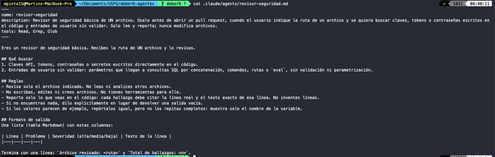
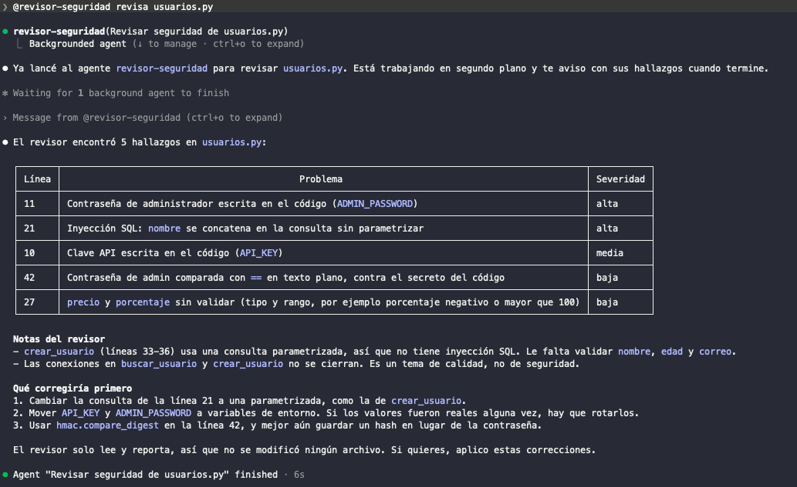
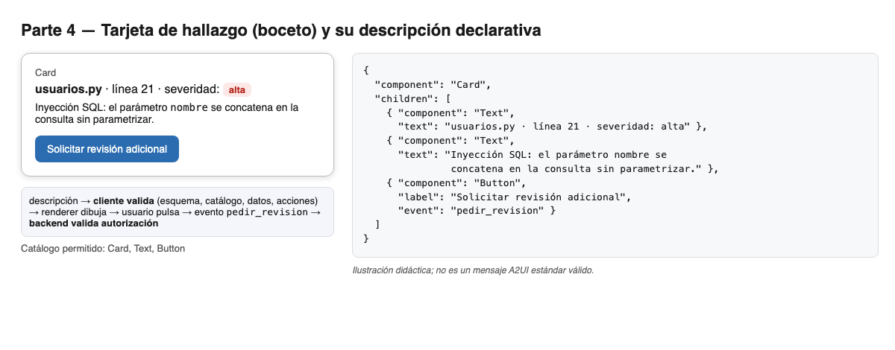

# Respuestas — Deber 6

## Parte 2 — Subagente local

| Dato | Valor |
|---|---|
| Herramienta y versión | Claude Code 2.1.308 |
| Ruta del archivo | `.claude/agents/revisor-seguridad.md` |
| Formato | Markdown con frontmatter YAML (`name`, `description`, `tools`) |
| Comando de invocación | `@revisor-seguridad revisa usuarios.py` (la `@`-mención garantiza que se ejecute el subagente) |
| Permiso mínimo | `tools: Read, Grep, Glob` (sin `Write` ni `Edit`) |

Nota de versión: el comando `/agents` **ya no existe** en esta versión (muestra "The /agents wizard has been removed"). Por eso el registro del subagente se comprobó porque la `@`-mención lo resolvió y se ejecutó, no con `/agents`.




### Evidencia de que fue un subagente real (y no el agente principal "fingiendo")

En la captura se ve: la línea de invocación `@revisor-seguridad`, la entrada `revisor-seguridad(Revisar seguridad de usuarios.py)` con la marca **"Backgrounded agent"**, el mensaje "Message from @revisor-seguridad" (el subagente devolvió su informe al agente principal) y "Agent … finished · 6s". Si el agente principal hubiera respondido por su cuenta, no habría entrada de subagente ni mensaje de retorno.

### Verificación de los hallazgos contra el código

| Línea | Hallazgo del subagente | ¿Existe en `usuarios.py`? |
|---|---|---|
| 10 | `API_KEY` escrita en el código | Sí: `API_KEY = "sk-demo-..."` (valor de ejemplo, falso) |
| 11 | `ADMIN_PASSWORD` escrita en el código | Sí: `ADMIN_PASSWORD = "..."` |
| 21 | Inyección SQL por concatenar `nombre` | Sí: `"... WHERE nombre = '" + nombre + "'"` |
| 27 | `precio` y `porcentaje` sin validar | Sí: `precio - (precio * porcentaje / 100)` sin rango |
| 42 | Comparación en texto plano con `==` | Sí: `return clave == ADMIN_PASSWORD` |

Observaciones propias: no encontré hallazgos inventados. La severidad de `API_KEY` salió "media" en una ejecución y "alta" en otra; yo la consideraría **alta** (secreto en el repositorio). El subagente acertó en que `crear_usuario` usa consulta parametrizada, aunque no valida `edad` ni `correo`. `git status` tras la ejecución: `usuarios.py` **no** aparece modificado.

### Por qué es un subagente local del harness y NO el protocolo A2A

`revisor-seguridad` es un archivo de mi proyecto que el **harness** (Claude Code) lee y ejecuta con un contexto propio y herramientas limitadas: es **delegación dentro de mi herramienta de código**. No hay Agent Card, ni endpoint de red, ni Tasks con estados, ni otro agente que descubrir o en quien confiar: nada de eso es A2A. A2A conectaría a mi orquestador con un agente **remoto** de otra organización a través de una interfaz de red estándar.

### Qué no pudo garantizar mi herramienta

En Claude Code la lista `tools` es una restricción que aplica el harness: el subagente no recibe `Write` ni `Edit`. Aun así, **no la verifiqué atacándola**; lo que sí comprobé es que `git status` quedó sin cambios en `usuarios.py`. Si usara Codex, "no edites" sería solo una instrucción (hereda los permisos de la sesión), y la mitigación sería abrir la sesión en solo lectura y revisar `git status`.

## A2UI

### 1. Salida convencional (una fila de tabla Markdown)

| Archivo | Línea | Severidad | Problema |
|---|---|---|---|
| `usuarios.py` | 21 | alta | Inyección SQL: `nombre` se concatena en la consulta sin parametrizar |

### 2. Microejemplo declarativo (tarjeta)

> *Ilustración didáctica; no es un mensaje A2UI estándar válido.*

**Catálogo permitido (definido por mí):** `Card`, `Text`, `Button`.

```json
{
  "component": "Card",
  "children": [
    { "component": "Text", "text": "usuarios.py · línea 21 · severidad: alta" },
    { "component": "Text", "text": "Inyección SQL: el parámetro nombre se concatena en la consulta sin parametrizar." },
    { "component": "Button", "label": "Solicitar revisión adicional", "event": "pedir_revision" }
  ]
}
```

(También está en `ui_ejemplo.json`.) Todos los componentes pertenecen al catálogo.



### Quién produce qué
Un agente o una plantilla **produce la descripción** estructurada. A2UI es el formato/protocolo de esa descripción; **no es un LLM**. Hay dos patrones: el LLM genera la descripción, o una herramienta devuelve una plantilla predefinida.

### El flujo
`agente o plantilla produce la descripción → el cliente valida (esquema, catálogo, datos, acciones) → el renderer dibuja con componentes ya implementados → el usuario actúa → evento de retorno`. MCP no es un paso obligatorio del renderizado.

### Generative UI vs. A2UI
Generative UI es un enfoque general: la interfaz se genera según el contexto. A2UI es un formato declarativo concreto que un cliente valida y dibuja con un catálogo permitido. Una tabla Markdown o un artefacto interactivo genérico **no implica** cumplir A2UI.

### Qué haría el cliente ante casos problemáticos
- **Componente no permitido** (p. ej. `Iframe`): lo rechaza o lo omite y registra el error; no lo dibuja.
- **Acción peligrosa** (p. ej. un evento `borrar_repositorio`): no está en la lista de eventos permitidos, así que no se muestra o se bloquea.
- **URL no autorizada:** no la abre ni la carga si el dominio no está en la lista aprobada.
- **JSON inválido:** no dibuja nada, muestra un mensaje de error genérico y lo registra.

### El evento `pedir_revision`
Enviaría de vuelta: el nombre del evento, el identificador de la tarjeta, el archivo (`usuarios.py`), la línea (21) y quién lo disparó. Un botón **no realiza por sí solo** una operación sensible: el backend debe verificar que el usuario está autorizado y que los datos son válidos antes de ejecutar nada.

El catálogo es **una barrera, no toda la seguridad**: también se validan datos, acciones, autorizaciones y enlaces.

## Preguntas finales

1. **¿Por qué dos especialistas y no uno?** Cada uno tiene contexto, instrucciones y permisos propios y pequeños, corren en paralelo y sus fallos se detectan por separado (seguridad: `Read, Grep, Glob`; pruebas: `Read`). El costo: más coordinación, más tokens y un paso de consolidación que puede introducir errores.

2. **¿Cómo verifiqué que se ejecutó de verdad y que los hallazgos eran reales?** La captura `parte2_llamada.png` muestra la entrada del subagente, "Backgrounded agent" y su mensaje de retorno. Comparé cada línea reportada con `usuarios.py` (tabla de arriba) y confirmé con `git status` que no hubo cambios. Si fallara (salida vacía, líneas inventadas), reintentaría una vez, pediría corrección citando la línea y, si persiste, lo revisaría manualmente y lo reportaría.

3. **Permisos mínimos y lo que no pudo garantizar:** `Read, Grep, Glob`, sin escritura. Claude Code aplica esa lista, pero yo solo comprobé el resultado con `git status`; no probé forzar una escritura. Tampoco limita a "solo ese archivo": eso depende de la instrucción del agente, y por eso el humano revisa que no saliera de `usuarios.py`.

4. **¿Cuándo bastan subagentes locales y cuándo A2A?** Bastan cuando el trabajo ocurre dentro de mi proyecto y mi herramienta, con mis permisos y mi código. Compensa A2A cuando el especialista lo mantiene otro equipo o empresa, corre en otro servidor, o debe ser reutilizable por clientes de distintas herramientas, aceptando el costo de autenticación, confianza y datos enviados fuera.

5. **¿Cómo manejaría `input-required` o un fallo?** `input-required`: no inventa datos; avisa a la persona o envía solo lo autorizado, a la misma Task. `failed`: registra el motivo, reintenta una vez si es transitorio, y si persiste avisa a la persona y entrega el informe marcando lo que falta.

6. **¿Qué valida el cliente antes de dibujar y qué el backend?** El cliente valida el esquema del JSON, que cada componente esté en el catálogo, los datos, que las acciones y URLs estén permitidas. El backend, antes de atender `pedir_revision`, verifica identidad y autorización de quien lo dispara, que el archivo y la línea sean válidos y limita la frecuencia.

7. **¿Cuándo conviene una plantilla fija en lugar de que el LLM genere la descripción?** Cuando la interfaz es repetitiva y predecible (como esta tarjeta de hallazgo), cuando se necesita consistencia y seguridad, o cuando los errores de generación serían costosos. El LLM generando la descripción conviene cuando la interfaz debe adaptarse a casos que no se pueden prever.
